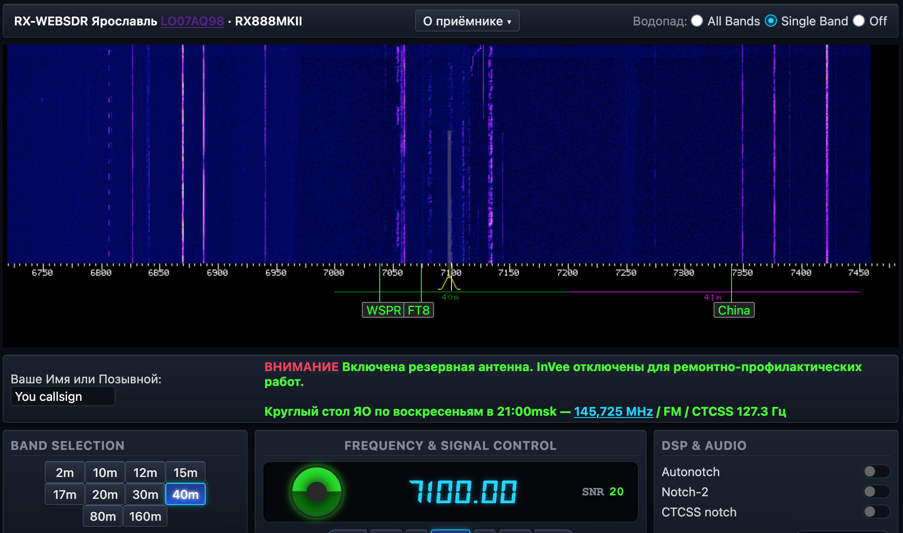

# rx-websdr — Multi-band WebSDR server (RX888 / ka9q-radio)

[Русский](README.md) | **English**

A WebSDR server working with the
RX888MKII receiver and the [ka9q-radio](https://github.com/ka9q/ka9q-radio)
software stack (Phil Karn, KA9Q). It streams a waterfall and audio to the
browser over WebSocket, decoding the IQ streams that `radiod` publishes
over multicast RTP.

The project was developed for a personal server in Yaroslavl (srr-76.ru) and is
tailored to servers with diverse hardware: minimal dependencies, single-file
configuration, systemd-managed startup.

> **Live example:** the online receiver in Yaroslavl — <https://websdr.srr-76.ru>
> (HF 0–30 MHz + 2m VHF). A global map of all servers connected to the network —
> <https://srr-76.ru/listsdr.html>.



> **Installing and configuring `radiod` (receiver, multicast, calibration) —
> follow the KA9Q author's own documentation:** https://github.com/ka9q/ka9q-radio.
> This repository contains only the WebSDR part (server + HTML5 client) and
> assumes `radiod` is already set up and publishing the required streams.

---

## Table of Contents

- [Architecture](#architecture)
- [Features](#features)
- [Repository structure](#repository-structure)
- [Requirements](#requirements)
- [Installation](#installation)
- [Configuration](#configuration)
- [Running and services](#running-and-services)
- [Test server (clone)](#test-server-clone)
- [Global monitoring](#global-monitoring)
- [rx-\* client (HTML5)](#rx--client-html5)
- [Frequently asked questions](#frequently-asked-questions)
- [Licenses and attribution](#licenses-and-attribution)

---

## Architecture

The data flow is:

```
 antenna → RX888MKII (USB) → radiod (ka9q-radio) → multicast RTP (lo)
        → pcmrecord → FIFO (/home/radio/fifo/fifo<band>) → rx-websdr
                                                       → browser (HTML5)
```

1. **radiod** publishes each band as a separate RTP multicast stream
   (`<band>-pcm.local`, resolved by avahi to `239.x`). Details are in the KA9Q
   documentation.
2. **receiver.service** runs the `start-receiver.sh` script, which starts
   **pcmrecord** for every band (`pcmrecord -c -r -S <ssrc> <group>`), writing
   raw IQ samples to a named FIFO channel.
3. **websdr.service** runs `rx-websdr -c cfg/websdr.cfg` — the server reads the
   FIFO, computes FFT/spectrum/audio and serves clients over HTTP/WebSocket.
4. The browser loads the HTML5 client (`pub/rx-base.js`, `rx-waterfall.js`,
   `websdr-sound.js`) and receives the waterfall (format-9) and audio
   (format-11).

This layout allows **running several servers in parallel** on one receiver:
multicast delivers a full copy of the stream to every listener, so a test
server (see below) does not disturb the main one.

### Default ports
Different ports may be assigned, depending on the situation. For example:
| Purpose | Port |
|---|---|
| Main WebSDR | 80 |
| Test WebSDR (clone) | 8090 |

---

## Features

- Any number of bands (typically 5–15; the only lower bound is your hardware),
  each with its own bandwidth, frequency step and flexible settings.
- HTML5 client: waterfall (format-9), zoom/pan with spectrum recomputation
  (bin = 1 px), audio (format-11), S-meter, level graph, DX labels from
  `stationinfo.txt`, DX cluster (`/~~fetchdx` — see FAQ), chat, log, WAV
  recording.
- **FT8 decoder** — the **FT8** button in the mode row opens a decoder window:
  live FT8 decodes from all bands (160..10 m) in a table with auto-refresh and
  filtering by the current band.
  Backend: the `[FT8]` section in radiod (multicast `ft8-pcm.local`) →
  pcmrecord → decode_ft8 (ka9q/ft8_lib) → log; the server serves the tail
  via `/~~ft8`.
- Per-band `freqoffset` to compensate frequency offset (see Configuration).
- **Global monitoring** — publishing your server in the list of rx-webSDR
  servers running on the network (`srr-76.ru/listsdr.html`): a world map +
  statistics (see the "Global monitoring" section).
- **Chat admin panel** (`/~~admin`) — moderation: message removal, ban by
  callsign and by IP/CIDR, auto-clearing the banned callsign's history
  (see the "Chat admin panel" section).
- Reliable restart via systemd (timeouts, kill groups, curl port check).
- Light infrastructure: only `libwebsockets`, `fftw3`, `libbsd`, `iniparser`, `libcurl`.

---

## Repository structure

```
rx-websdr/
├── Makefile               # build (needs pkg-config dependencies)
├── start.sh               # manual (re)start of the stack via systemd
├── start-receiver.sh      # starts pcmrecord writers (for receiver.service)
├── cfg/
│   └── websdr.cfg         # main server config (port, bands, freqoffset)
├── src/                   # server sources (C)
├── pub/                   # static files + HTML5 client
└── rx-websdr              # compiled binary
```

---

## Requirements

- Linux (tested on Debian/Ubuntu), `gcc`, `make`, `pkg-config`.
- `radiod` from ka9q-radio (configured and publishing IQ streams) — see the
  KA9Q link.
- Build libraries (Debian/Ubuntu):
  ```bash
  sudo apt install build-essential pkg-config \
    libwebsockets-dev libfftw3-single3 libfftw3-dev libbsd-dev libiniparser-dev
  ```
  (The `libwebsockets` package name may differ — see the build.)
- `pcmrecord` (part of ka9q-radio), `avahi-daemon` (resolves
  `<band>-pcm.local`).

---

## Installation

1. Get the sources:
   ```bash
   git clone https://github.com/AndyLinwood/rx-websdr.git
   cd rx-websdr
   ```
2. Build:
   ```bash
   make
   # the ./rx-websdr binary will appear
   ```
3. Create the FIFO directory and named channels for your bands (root required):
   ```bash
   sudo mkdir -p /home/radio/fifo
   # one channel per band; the name must match the device in the config:
   sudo mkfifo /home/radio/fifo/fifo40m
   ```
   The number of bands is yours — create as many channels as there are
   `band` sections in your config. For convenience there is a sample script
   **`sfifo.sh`** — edit its band list to match yours and run it:
   ```bash
   sudo ./sfifo.sh            # creates channels from the BANDS list in the script
   sudo ./sfifo.sh 80m 20m 2m # or only selected bands
   ```
   Band names and FIFO paths are set in `cfg/websdr.cfg` and
   `start-receiver.sh` — they must match (see below).
4. Install the systemd units (samples are in `start.sh`/`start-receiver.sh`;
   the actual unit files are created from the templates in the file comments):
   - `receiver.service` → `ExecStart=/path/to/start-receiver.sh`
   - `websdr.service` → `ExecStart=/path/to/rx-websdr -c cfg/websdr.cfg`
5. Start the stack: `./start.sh`.

> Full step-by-step setup (order radiod→receiver→websdr, timing, diagnostics)
> is in the "Running and services" section and in the `start.sh` comments.

---

## Configuration

All server settings are in `cfg/websdr.cfg`. Key directives in brief:

| Directive | Description |
|---|---|
| `tcpport 80` | HTTP/WebSocket port |
| `maxusers 200` | concurrent client limit |
| `idletimeout 5400` | client idle timeout, ms |
| `band <name>` | start of a band block (10mH, 40m, UVB…) |
| `device /home/radio/fifo/fifo40m` | FIFO for this band |
| `samplerate 384000` | IQ sample rate of the tap |
| `centerfreq 7100` | band center frequency, kHz |
| `gain 24` | spectrum gain |
| `freqoffset -452` | frequency offset (Hz) relative to nominal (per-band) |
| `buttonlink 2m\|https://…` | band button linking to an external rx-WebSDR (label\|URL) |

### freqoffset

Compensates the systematic frequency offset of the receiver (analog/heterodyne
effects). Set per-band in Hz; the sign follows the direction of the shift
("−" if the station appears above the nominal frequency). Applied
consistently to the center/labels/scale and the tuner. Adjust it using a known
station (e.g., the UVB 4625 kHz beacon).

### Bands and FIFO

FIFO names are uniform: `fifo<band-name>` (e.g., `fifo40m`, `fifo80m`,
`fifoUVB`). They must match by name in `cfg/websdr.cfg` (`device`) and in
`start-receiver.sh` (`/home/radio/fifo/fifo<name>`).

### Band buttons for external servers (`buttonlink`)

Additional buttons in the band row that link to **external** rx-WebSDR servers
(not bands of this receiver) — e.g., a neighbouring VHF/UHF server on another
band. Format:

```
buttonlink <label>|<URL>
```

- `<label>` — the text on the button (e.g., `2m`);
- `<URL>` — the address of the external server, opened in a new tab;
- any number of lines is allowed (limit 16);
- `|` is the separator, because the URL may contain spaces/special characters.

Example (the 2m band of the neighbouring `ua3mrs.ru` server with a preset
frequency):

```
buttonlink 2m|https://ua3mrs.ru/#freq=145725000,mod=nfm,sql=-47
```

The buttons are rendered by the client (`pub/rx-base.js`) in the same style as
band buttons and appear automatically after a server restart.

---

## Running and services

The stack is managed by systemd. The correct order:

```
radiod@rx888.service  (receiver, publishes multicast)
   → receiver.service (pcmrecord → FIFO, writers)
      → websdr.service (rx-websdr, FIFO readers)
```

### start.sh

Manual (re)start: `./start.sh`

The script itself:
1. starts `radiod@rx888` if it is inactive;
2. restarts `receiver.service` and waits until all `pcmrecord` writers
   (one `start_band` line per writer in `start-receiver.sh`) are attached to
   their FIFOs;
3. restarts `websdr.service`;
4. waits until `:80` answers HTTP (curl) and reports the status.

### Units (samples)

`/etc/systemd/system/receiver.service`:
```ini
[Unit]
Description=WebSDR receiver (pcmrecord -> fifo)
Requires=network-online.target
After=radiod@rx888.service
Before=websdr.service

[Service]
Type=exec
ExecStart=/home/radio/rx-websdr/start-receiver.sh
Restart=always
RestartSec=3
KillMode=control-group
TimeoutStopSec=10

[Install]
WantedBy=multi-user.target
```

`/etc/systemd/system/websdr.service`:
```ini
[Unit]
Description=WebSDR (our project)
Requires=network-online.target
After=receiver.service

[Service]
Type=exec
WorkingDirectory=/home/radio/rx-websdr
ExecStartPre=-/bin/pkill -9 -x rx-websdr
ExecStart=/home/radio/rx-websdr/rx-websdr -c cfg/websdr.cfg
Restart=on-failure
RestartSec=3
KillMode=control-group
TimeoutStopSec=10

[Install]
WantedBy=multi-user.target
```

Notes:
- `KillMode=control-group` + `TimeoutStopSec=10` — pcmrecord/rx-websdr may
  ignore SIGTERM (blocked in FIFO I/O); this makes shutdown fast and prevents
  a 90-second hang.
- `ExecStartPre=-/bin/pkill -9 -x rx-websdr` — frees the port at startup
  (only our own process, matched by binary name). **Do not duplicate** pkill
  in `ExecStop` — it would kill the new instance on `systemctl restart`
  (a race on the name).

### Diagnostics

```bash
systemctl status websdr.service receiver.service radiod@rx888.service
journalctl -u websdr -n 50 --no-pager
curl -sf http://127.0.0.1:80/ && echo ok     # HTTP is ready
```

If the waterfall is "empty" right after startup — the server needs a few
seconds to warm up the FFT history; refresh the page.

---

## Test server (clone)

For development, a **local test setup** is used (a second server instance on
port **8090** with its own FIFOs and unit files
`receiver-test.service`/`websdr-test.service`), letting you test the client
and server without affecting the main :80 instance: both servers read the
same radiod multicast streams, but each writes to its own FIFOs. This is an
internal project tool and **is not part of the distribution**; it is mentioned
in the docs only to explain why parallel instances are possible.

---

## Global monitoring

Starting with the registry-enabled version, the server can **publish itself
in the common list of running rx-WebSDR servers** — at
[https://srr-76.ru/listsdr.html](https://srr-76.ru/listsdr.html) you can see
a world map and statistics of all registered receivers (location, callsign,
bands, real-time listener count).

The live network statistics are also available as an **open JSON API**
(no keys or rate limits, CORS is open — callable right from the browser):

```bash
curl https://srr-76.ru/api.php
```

The response refreshes every 30 seconds and contains coordinates, callsign,
QTH, SDR, bands, listener count and uptime of every server — suitable for
your own dashboards, bots and integrations.

Mechanics: a background thread (`src/registry.c`) sends the server's current
state to the aggregator (JSON POST via `libcurl`): coordinates, name,
callsign, antenna, SDR, listener count, uptime. The aggregator URL is
**hardcoded in the code** (`https://srr-76.ru/api.php`) and is not configured
in the config file — it is a constant of the network protocol. The heartbeat
period is taken from the aggregator's response (`next_heartbeat_in`), not
from the config. The aggregator (the `srr-76.ru` site) collects this data and
shows it on `listsdr.html`.

A new server registers automatically: the aggregator issues a one-time
**verify_token**, the server returns it in the next heartbeat, after which the
entry is created. No manual id entry is needed — it is generated from
`registry_website` (hostname of the URL) or from the machine hostname.

### Settings (section `# === Registry` in `cfg/websdr.cfg`)

| Directive | Value (example) | Description |
|---|---|---|
| `registry_enabled yes` | `yes`/`no` | enables publishing in the server list |
| `registry_server_id` | *(optional)* | explicit identifier; without it, generated from `registry_website` |
| `registry_name` | `Yaroslavl RX-WebSDR` | displayed server name |
| `registry_owner_call` | `R3MAV` | owner callsign |
| `registry_qth` | `Yaroslavl, Russia` | geographic description (city/country) |
| `registry_lat` | `57.62` | latitude (decimal degrees) for the map |
| `registry_lon` | `39.85` | longitude (decimal degrees) for the map |
| `registry_website` | `https://websdr.srr-76.ru` | link to the server site/page (and the source of the auto-id) |
| `registry_desc` | `HF receiver 0-30 MHz` | server description |
| `registry_antenna` | `Inverted V` | antenna |
| `registry_sdr_model` | `RX888 MkII modified` | SDR model |

> **Dependency:** registry requires `libcurl` (added to the `Makefile`;
> Debian/Ubuntu — package `libcurl4-openssl-dev`).
>
> **Privacy:** the server publicly reports the owner's coordinates, callsign
> and QTH (see `registry_lat/lon/owner_call/qth`). If you do not want to
> publish the exact location, disable the feature (`registry_enabled no`) or
> specify approximate coordinates.

> **Deprecated directives:** `registry_endpoint`, `registry_interval` and
> `registry_max_users` are **no longer used** — the endpoint is hardcoded,
> the interval is set by the aggregator (see above), the listener limit is
> taken from `maxusers`. You can remove them from the config.

---

## rx-\* client (HTML5)

The client lives in `pub/`:

| File | Purpose |
|---|---|
| `websdr-head.html`, `websdr-controls.html` | markup (frontend boundary) |
| `classic.css`, `style.css`, `styles.less` | styles |
| `rx-base.js` | main client (reworked websdr-base.js: sections, comments, fixes) |
| `rx-waterfall.js` | HTML5 waterfall (prep_html5waterfalls) — ours |
| `websdr-sound.js` | HTML5 sound (PA3FWM license, see the Licenses section) |
| `bandinfo.js` / `tmp/*.png` | generated by the server (scale grid) |

`websdr-head.html` includes `rx-base.js`; it dynamically loads
`rx-waterfall.js` (waterfall) and `websdr-sound.js` (sound). Notable points:

- **reset/zoom:** the server recomputes the spectrum for every zoom level
  (bin = 1 px) instead of stretching the finished picture — this removes
  "fir-tree" artifacts when zooming.
- **fetchdx:** the server does not implement `/~~fetchdx` yet; after the first
  404 the client stops polling it and shows only local station labels from
  `stationinfo` (see the FAQ).

---

## Chat admin panel

Moderating the chat via `https://<host>/~~admin`.

- Password-protected: the `adminpass` directive in `cfg/websdr.cfg`
  (an empty value disables the admin panel). Login via a form, the session is
  a cookie.
- **Deleting a message** — the `[delete]` button next to a row in the feed
  (last 100).
- **Ban** — the "Ban" field accepts a callsign (exact, case-insensitive) or
  an IP/CIDR (`1.2.3.4`, `203.0.113.0/24`). Clicking a callsign in the feed
  fills it into the ban field. When banning a **callsign**, the server
  automatically finds its IP (from live connections and the visitor log
  `visitorsfile`) and bans both the name and the IP — a standalone name-ban no
  longer "leaks". Geo-names like `RU,City` are ignored when matching, so you
  do not accidentally block every IP in one city. The banned user's messages
  are removed.
- **Unban** — the `[unban]` button in the list of banned entries.
- The ban list is stored in the `banfile` (default `banlist.txt`), one entry
  per line (`#` is a comment). The file is reread on every change; it is not
  part of git on the server.

## Frequently asked questions

**Why do I see 404s on `/~~fetchdx` in the browser console?**
The server does not implement the network DX message set. After the first 404
the client sets a flag (`dxserverdead`) and stops polling. Local station
labels (stationinfo) are still shown.

**How do I add a band?**
1. Add a `band <name>` section in `cfg/websdr.cfg` (centerfreq, samplerate,
   device…);
2. add a `start_band <ssrc> "<band>-pcm.local"
   /home/radio/fifo/fifo<name>` line in `start-receiver.sh`;
3. recreate the FIFO: `sudo mkfifo /home/radio/fifo/fifo<name>`;
4. `./start.sh`.

**How do I find the right freqoffset?**
Tune to a known station (e.g., UVB 4625 kHz) and look at the client's
frequency readout; the difference in Hz (with its sign) is the `freqoffset`
value for that band.

**Can I run several servers on one receiver?**
Yes: the radiod multicast streams allow any number of listeners; each server
uses its own FIFOs and its own `pcmrecord`. See "Test server (clone)".

---

## Licenses and attribution

The rx-websdr project is grateful to the authors of the code it builds upon
and strives to honor their terms:

- **WebSDR (PA3FWM, websdr.org)** — the source of the idea and of the client
  part. The PA3FWM HTML5 client is distributed under "all rights reserved"
  (the `websdr-sound.js` header): the author allows use **only unmodified,
  through his original WebSDR software, for original WebSDR clients**; any
  other distribution (in whole or in part, inside other software,
  reverse-engineering) requires his explicit permission. We honor this term:
  `websdr-sound.js` is included without our changes (it contains the 2020
  KA7OEI edits agreed with the author — de-emphasis and additional filters),
  while our own client `rx-base.js`/`rx-waterfall.js` is an independent
  rework for our server.
- **ka9q-radio (Phil Karn, KA9Q)** — the reception stack: `radiod`, `pcmrecord`
  and the FT8 decoder code. Distributed under **GPL v3** (`LICENSE.TXT` in his
  repository: https://github.com/ka9q/ka9q-radio). We recommend installing and
  configuring it per the author's documentation.
- **jquery-3.1.1.min.js** — jQuery, MIT license.
- Everything else (the C server, `rx-base.js`, `rx-waterfall.js`, styles,
  markup) is original work of the rx-websdr project.

Unless otherwise stated, the code in this repository is distributed under the
project author's license (by default — all rights reserved, commercial use by
agreement). There is no separate `LICENSE` file in the repository yet; we
recommend adding one before a wider public release.